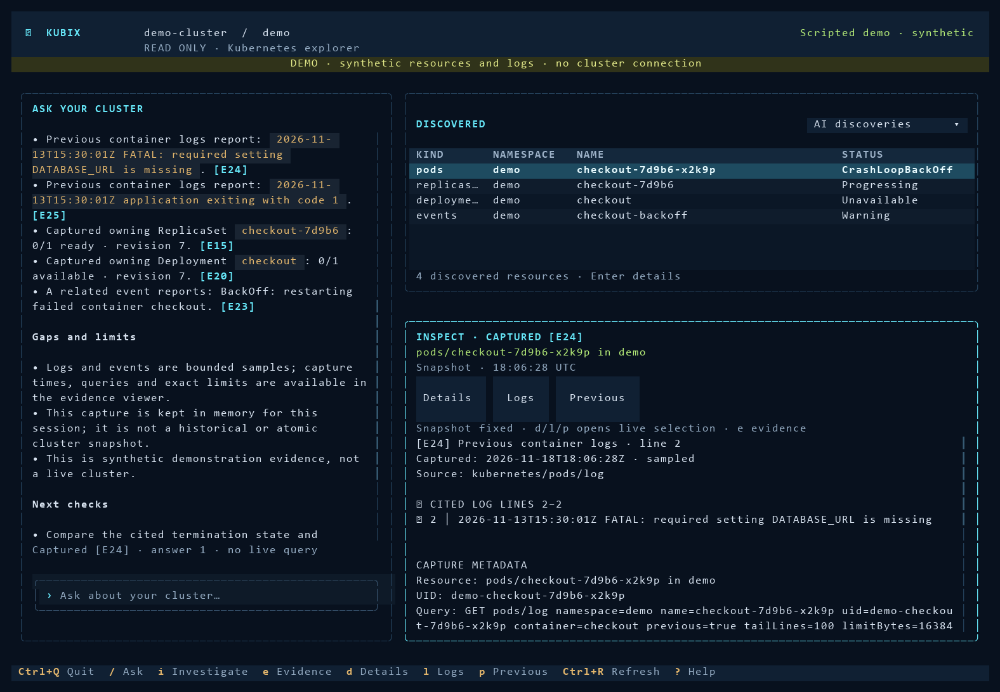
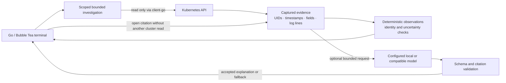

# Kubix

**Investigate Kubernetes failures. Keep the evidence in view.**

Kubix is a read-only terminal UI for platform engineers and SREs. It combines
resource browsing, bounded log collection, captured source citations, and
optional local-model explanations. The point is not to automate a confident
answer: it is to make an investigation easier to inspect, including what could
not be learned.

[Try the demo](#try-it-in-two-minutes) · [Architecture](#how-it-works) ·
[Live validation](#what-has-been-validated) · [Usage guide](docs/usage.md)



*Actual Go/Bubble Tea view rendered by the offline snapshot test. Synthetic
resources and scripted responses; not a production incident or live-model result.
The right pane shows the exact captured log line behind a citation.*

## What makes it useful

- **Follow a failure, not just a prompt.** A Pod investigation collects its
  identity, container state, owner chain, events, and current/previous logs.
- **Inspect the source behind an answer.** A citation opens the captured field
  or numbered log line, with timestamp, UID, query and collection limits. It does
  not silently reread a replacement Pod.
- **Keep uncertainty visible.** Permission failures, missing history, changed
  identities and bounded samples remain gaps. Known ambiguous cases use
  deterministic evidence instead of an unsupported model diagnosis.
- **Inspect Service routing without model guesswork.** Compare an explicitly
  named Pod with a selected Service, or query selector-matching Pods. The server
  filters results; pages remain bounded and truncation stays visible. See
  [Service routing behavior](docs/service-routing.md).
- **Keep control of the cluster.** Kubix has no mutation, shell, pod-exec or
  port-forwarding tools. Read-only RBAC is an independent boundary.
- **Use models selectively.** Inspection works without a model. Configure a
  local OpenAI-compatible server for explanations; there is no default hosted
  endpoint or required hosted-model account.

This is an early, focused investigation tool, **not a k9s replacement or an
incident autopilot**. A valid citation proves provenance, not diagnostic truth.

## Try it in two minutes

Build from source with **Go 1.26+**. The resulting binary needs neither Go nor
Python installed. Initial dependency downloads require network access.

```sh
git clone https://github.com/evan-ctrlai/kubix.git
cd kubix
go build -o bin/kubix ./cmd/kubix
./bin/kubix --demo
```

Windows PowerShell:

```powershell
git clone https://github.com/evan-ctrlai/kubix.git
cd kubix
go build -o bin/kubix.exe ./cmd/kubix
.\bin\kubix.exe --demo
```

Use a terminal at least 65 × 22; 140 × 44 makes the evidence easier to read.
In the synthetic demo:

1. Press `Esc`, select the checkout Pod, then `i` to capture an investigation.
2. Open an underlined evidence citation, or press `e` to choose one by keyboard.
3. Compare the captured source with `d` (details), `l` (current logs) or `p`
   (previous logs). Press `Ctrl+Q` to exit.

`--demo` without an explicit model endpoint is offline and scripted. It requires
neither Kubernetes credentials nor a model server. For a short walkthrough and
screenshot reproduction, see [the demo guide](docs/demo.md).

## Connect to a real cluster

Prefer a dedicated read-only kubeconfig and choose scope explicitly:

```sh
./bin/kubix --kubeconfig /path/to/reader-config --context my-cluster --namespace my-app
```

Press **Ctrl+K** for in-app context selection. Switching cancels outstanding work
and clears the old conversation and evidence. Namespace scope follows the chosen
context unless explicitly overridden with `--namespace` or `-A`. In the resource
pane, **[ / ]** navigate bounded pages; Ctrl+R restarts at the first page.
Kubix does not change your current kubeconfig context and does not aggregate
multiple clusters into one investigation. Without a model you can
browse resources, inspect logs, capture Pod evidence and use supported
deterministic investigations. General natural-language questions need a model.

For a local OpenAI-compatible model server:

```sh
./bin/kubix --context my-cluster --namespace my-app --model-url http://localhost:8000/v1 --model YOUR_MODEL
```

The selected evidence and question go to the endpoint you configure. Local
inference is supported; **real-cluster operation is not universally offline**.
See [model configuration, timeouts and data boundaries](docs/usage.md#connect-an-open-weight-model).

## How it works



Model tools expose reads only. Pod summaries use one schema-constrained request
with tools disabled after collection. Invalid/unavailable summaries fall back to
evidence. Current and previous-container logs remain different sources.

The tradeoff is deliberate: bounded, sequential reads are easier to reason about
and constrain, but they are **not an atomic snapshot or complete cluster history**.
See [package boundaries and design details](docs/development.md).

## What has been validated

| Layer | Evidence | What it does **not** prove |
| --- | --- | --- |
| Offline demo | Actual terminal rendering and captured-citation interaction tests using synthetic resources | Real model quality or production behavior |
| Automated tests | Fake Kubernetes clients, local HTTP servers, source-identity/citation, cancellation, layout and read-only guard tests | Every live-cluster integration or terminal platform |
| Controlled real lab | Isolated kind cluster; missing-configuration CrashLoop; scoped reader; local Ollama/Qwen model; retained pass/fail records | A general diagnosis success rate |
| Difficult evidence cases | Conflicting temporal claims, unavailable previous logs, selector mismatch and denied EndpointSlice reads | That deterministic safeguards make a model generally reliable |

The [incident lab](labs/crashloop/README.md) contains setup, scope, pinned inputs,
verification and cleanup instructions. The [November 18 validation record](labs/crashloop/results/2026-11-18-bounded-validation.md)
retains failures as well as fixes. Timing results describe the recorded machine,
model and scenario, not an advertised performance guarantee.

For repeatable, independent current-log, healthy-history and Service-denial
checks, see the [scenario harness](labs/scenarios/README.md). It records source,
citation, timing and actual model-request counts. These conservative scenarios
exercise deterministic safeguards, not a model-accuracy benchmark.

## Boundaries

- No workload mutation, arbitrary shell execution, pod exec or port forwarding.
- No Secret-read tool. Redaction is best-effort, not a guarantee that arbitrary
  application logs contain no sensitive information.
- Manual refresh, bounded resource lists and log samples. Missing results do not
  establish that a resource or historical failure does not exist.
- Models can misinterpret valid evidence. Review the sources before acting.
- The application's captured Pod evidence is session-local, not a durable audit
  store. Explicit validation tools may write reports.
- No source license has been selected. Dependencies and model weights retain
  their own licenses; model weights are not distributed in this repository.

## Develop

```sh
go test ./...
go vet ./...
go build ./cmd/kubix
```

The offline lab guard tests additionally use PowerShell 7.2+:

```powershell
pwsh ./labs/crashloop/test.ps1
pwsh ./labs/scenarios/test.ps1
```

The [CI workflow](.github/workflows/ci.yml) is configured for Linux, Windows and
macOS, with the race detector on Linux. Check the [actual run results](https://github.com/evan-ctrlai/kubix/actions)
rather than inferring success from the workflow file.

[Full controls and limits](docs/usage.md) · [Development notes](docs/development.md) ·
[Two-minute demo](docs/demo.md)

