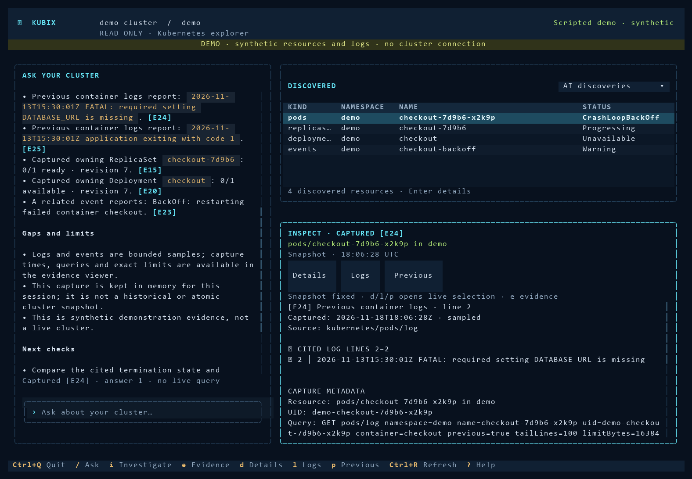

# Two-minute Kubix demo

## Offline walkthrough

Build and run `kubix --demo` as shown in the root README. Use a 140-column,
44-row terminal if possible. No cluster or model is needed for this walkthrough.

| Time | Action | Point to explain |
| --- | --- | --- |
| 0:00–0:20 | Show the synthetic-demo banner and resource browser | This is a demonstration fixture, not a production incident. |
| 0:20–0:50 | `Esc`, select checkout Pod, `i` | A bounded collection captures sources before an explanation is shown. |
| 0:50–1:20 | Click a log citation, or `e`, arrows, `Enter` | Inspect the exact captured line, source query, UID and timestamp. |
| 1:20–1:45 | `d`, `l`, `p`; then reopen the captured citation | Captured evidence and a new resource read are different views. |
| 1:45–2:00 | Show the gaps and limits; `Ctrl+Q` | No remediation runs. Source provenance is not proof that a diagnosis is correct. |

For an actual cluster/local-model demonstration, follow the separate
[CrashLoop lab](../labs/crashloop/README.md). Run its verification on the presenting
machine first. Do not label the offline demo as a local-model measurement.

## Screenshot provenance



This PNG renders the real `Model.View()` output of
`TestCrashLoopCapturedDemoSnapshot` at 140 × 44. That test drives the demo
collector and agent, opens a rendered evidence citation and verifies the
captured failure line. It is a deterministic/headless terminal-view snapshot,
not a screenshot of a desktop terminal or a recording of a live incident.
Generated on November 18, 2026. Capture timestamps may change when regenerated.

The raw terminal view is retained in [crashloop-demo.ansi](assets/crashloop-demo.ansi).
No frames or diagnostic text have been fabricated or composited into the UI.

### Reproduce

PowerShell, from the repository root:

```powershell
$env:KUBIX_CRASHLOOP_SNAPSHOT_PATH = Join-Path (Get-Location) 'docs/assets/crashloop-demo.ansi'
go test ./internal/tui -run '^TestCrashLoopCapturedDemoSnapshot$' -count=1
Remove-Item Env:KUBIX_CRASHLOOP_SNAPSHOT_PATH
python -m pip install -r docs/requirements-render.txt
python docs/render_terminal_snapshot.py docs/assets/crashloop-demo.ansi
```

The optional renderer uses Python, Pillow and Rich; these are **documentation
rendering dependencies only**, not Kubix runtime dependencies. It accepts
`--font` and `--bold-font` when the default system monospace font is unavailable.
The Go test is the source of the screen; the renderer only maps ANSI styles and
terminal cells to pixels. It does not run Kubernetes or a model.

There is no prerecorded video in this repository yet. The screenshot and the
repeatable interactive walkthrough are the supplied demo artifacts.

